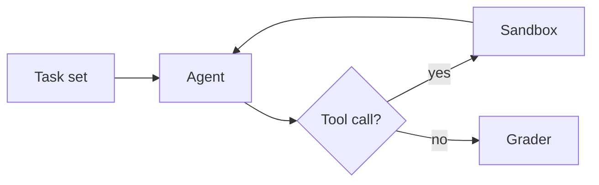
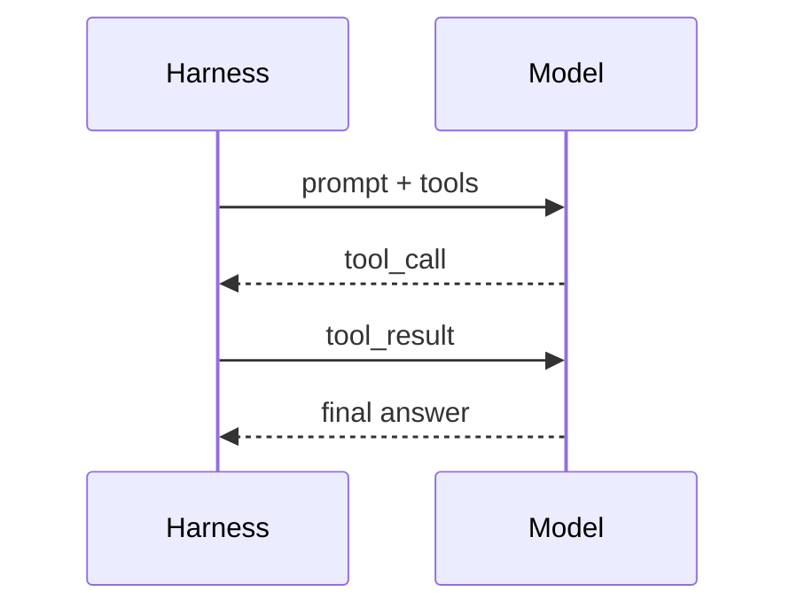

这是一段开篇正文。评测类文章最重要的是**数据可信、呈现克制**：读者应该第一眼看到结论，第二眼看到数据，第三眼才注意到排版。中英文混排时，像 GPT-5、SWE-bench Verified、pass@1 这样的西文词应当与中文自然衔接，不需要手动加空格也不会显得拥挤。

第二段用来观察段落间距。A paragraph in English should read just as comfortably: the measure is about 676px, the size is 17px, and the line height is generous enough for long-form reading without feeling loose.

## 文本格式

普通文本，**粗体**，*斜体*，***粗斜体***，~~删除线~~，`行内代码`，<kbd>⌘</kbd> + <kbd>K</kbd> 键盘按键，H<sub>2</sub>O 下标，E = mc<sup>2</sup> 上标，<mark>高亮标记</mark>，以及 <abbr title="Large Language Model">LLM</abbr> 缩写。

链接的几种形式：[站内链接](/)、[外部链接](https://openai.com/research)、自动链接 https://github.com/parkgogogo，以及带 `代码` 和 **粗体** 的 [复合链接 `pass@k` **metric**](https://arxiv.org/abs/2107.03374)。

一行很长的不可断内容用来测试换行：`averyveryveryverylongidentifierwithoutanyspacesthatmightoverflowthecontentcolumn_and_break_layout` 以及 https://example.com/a/really/long/url/that/keeps/going/and/going/without/any/natural/break/points/at/all

行末两个空格的硬换行，  
这里应该另起一行，但不形成新段落。

转义字符：\*不是斜体\*，\`不是代码\`，\# 不是标题，1\. 不是列表。价格 $5 和 $10 不会被识别成公式。

Emoji 与符号：✅ ⚠️ 🚀 → ← ↗ © ™ —— 中文破折号，"弯引号"，「直角引号」。

## 标题层级

### 三级标题：用于小节

#### 四级标题：用于更细的分组

##### 五级标题

###### 六级标题

### 含 `代码` 与 **强调** 的标题

## 列表

无序列表：

- 第一项
- 第二项，包含一个比较长的句子，用来观察列表项换行之后的悬挂缩进是否和首行文字对齐，而不是和圆点对齐。
- 第三项
  - 嵌套第一项
  - 嵌套第二项
    - 第三层嵌套
- 第四项

有序列表：

1. 准备数据集
2. 运行评测
   1. 运行 baseline
   2. 运行候选模型
3. 汇总结果

从 7 开始的有序列表：

7. 第七项
8. 第八项
9. 第九项
10. 第十项（两位数序号对齐）

任务列表：

- [x] 收集 500 个任务
- [x] 人工审核标注
- [ ] 跑完第二轮
- [ ] 写结论

松散列表（项之间有空行）：

- 第一项有多段内容。

  这是第一项的第二段。

- 第二项。

## 引用与提示

> 引用块用于摘录。Evaluating an agent is evaluating the model and the harness together.
>
> 第二段引用。
>
> > 嵌套引用。
>
> — Anthropic, *Demystifying evals for AI agents*

> [!NOTE]
> 补充说明：本文所有分数均为 3 次运行的平均值。

> [!TIP]
> 建议先看第 4 节的结论，再回来看方法。

> [!IMPORTANT]
> 带工具的成绩不应直接与不带工具的成绩比较。

> [!WARNING]
> 该基准存在数据污染风险，详见附录。

> [!CAUTION]
> 不要把这组数据用于生产决策。

## 表格

评测结果表（列对齐：左 / 右 / 右 / 右）：

| Model | SWE-bench Verified | Aider Polyglot | τ²-bench (retail) |
| :--- | ---: | ---: | ---: |
| GPT-5 (thinking) | **74.9%** | **88.0%** | 81.1% |
| OpenAI o3 | 69.1% | 79.6% | 80.2% |
| Claude Opus 4.1 | 74.5% | — | **82.4%** |
| GPT-4o | 30.8% | 25.8% | 64.0% |

两列指标表（带说明的行）：

| Metric | gpt-5-thinking-mini | OpenAI o4-mini |
| --- | --- | --- |
| Abstention rate<br>(no specific answer is given) | 52% | 1% |
| Accuracy rate<br>(right answer, higher is better) | 22% | 24% |
| Error rate<br>(wrong answer, lower is better) | 26% | 75% |
| Total | 100% | 100% |

很宽的表格（应当横向滚动，而不是撑破页面）：

| Task ID | Category | Difficulty | Baseline | Run 1 | Run 2 | Run 3 | Mean | Std | Tokens (in) | Tokens (out) | Latency (s) | Cost ($) | Notes |
| --- | --- | --- | ---: | ---: | ---: | ---: | ---: | ---: | ---: | ---: | ---: | ---: | --- |
| `swe-001` | refactor | hard | 0.42 | 0.61 | 0.58 | 0.63 | 0.607 | 0.021 | 182,331 | 12,904 | 341.2 | 1.84 | flaky test |
| `swe-002` | bugfix | medium | 0.55 | 0.72 | 0.70 | 0.74 | 0.720 | 0.016 | 96,120 | 8,311 | 188.7 | 0.97 | — |

表格内的复合内容：

| 语法 | 示例 | 说明 |
| --- | --- | --- |
| 行内代码 | `npx vitest run` | 等宽字体 |
| 链接 | [OpenAI](https://openai.com) | 下划线 |
| 公式 | $$O(n \log n)$$ | KaTeX 行内 |
| 强调 | **粗体** / *斜体* | — |

## 公式

行内公式使用双美元符：准确率 $$\text{acc} = \frac{TP + TN}{N}$$，以及无偏估计 $$\text{pass@}k$$。

块级公式：

$$
\text{pass@}k = \mathbb{E}_{\text{problems}}\left[1 - \frac{\binom{n-c}{k}}{\binom{n}{k}}\right]
$$

多行对齐：

$$
\begin{aligned}
\mathcal{L}(\theta) &= -\sum_{t=1}^{T} \log p_\theta(x_t \mid x_{<t}) \\
&\approx -\frac{1}{N}\sum_{i=1}^{N} \log p_\theta\big(y^{(i)} \mid x^{(i)}\big)
\end{aligned}
$$

## 图表

单系列柱状图，突出自己的模型（其余为描边）：

```chart
{
  "type": "bar",
  "title": "SWE-bench Verified",
  "subtitle": "Software engineering",
  "yLabel": "Accuracy, pass@1",
  "unit": "%",
  "yMax": 100,
  "labels": ["GPT-5 (thinking)", "GPT-5 (no thinking)", "OpenAI o3", "GPT-4.1", "GPT-4o"],
  "highlight": ["GPT-5 (thinking)", "GPT-5 (no thinking)"],
  "series": [{ "name": "pass@1", "values": [74.9, 52.8, 69.1, 54.6, 30.8] }],
  "caption": "All SWE-bench evaluation runs use a fixed subset of n=477 verified tasks."
}
```

分组柱状图：

```chart
{
  "type": "bar",
  "title": "Multimodal benchmarks",
  "subtitle": "With and without thinking",
  "unit": "%",
  "labels": ["MMMU", "MMMU-Pro", "VideoMMMU", "CharXiv"],
  "series": [
    { "name": "With thinking", "values": [84.2, 78.4, 84.6, 81.1] },
    { "name": "Without thinking", "values": [74.4, 62.7, 61.6, 59.7] }
  ]
}
```

折线图（推理强度 vs 输出 token）：

```chart
{
  "type": "line",
  "title": "CharXiv-Reasoning",
  "subtitle": "Scientific figure reasoning",
  "xLabel": "Output tokens (thousands)",
  "yLabel": "Accuracy, pass@1",
  "unit": "%",
  "yMin": 50,
  "yMax": 90,
  "series": [
    { "name": "GPT-5 (with thinking)", "points": [[1, 61, "minimal"], [3, 72, "low"], [6, 78, "medium"], [11, 81, "high"]] },
    { "name": "OpenAI o3", "points": [[4, 62, "low"], [9, 71, "medium"], [16, 76, "high"]] }
  ]
}
```

错误的图表配置应当给出可读的报错，而不是让整页崩溃：

```chart
{ "type": "pie", "series": [] }
```

## 图片

带标题（title）的图片，标题作为图注：


只有 alt 的图片，alt 作为图注：


alt 是文件名时不显示图注：


带链接的图片：

[](/)

段落内的行内图片  不应变成独立的 figure。

## 代码

TypeScript：

```ts
interface EvalResult {
  taskId: string;
  passed: boolean;
  tokens: { input: number; output: number };
}

export function passAtK(n: number, c: number, k: number): number {
  if (n - c < k) return 1;
  let result = 1;
  for (let i = n - c + 1; i <= n; i++) {
    result *= 1 - k / i; // numerically stable form
  }
  return 1 - result;
}
```

TSX：

```tsx
export function Score({ value }: { value: number }) {
  return <span className="score">{(value * 100).toFixed(1)}%</span>;
}
```

Python：

```python
import numpy as np

def pass_at_k(n: int, c: int, k: int) -> float:
    """Unbiased estimator from Chen et al. (2021)."""
    if n - c < k:
        return 1.0
    return 1.0 - np.prod(1.0 - k / np.arange(n - c + 1, n + 1))
```

Shell：

```bash
pnpm install
pnpm run eval --model gpt-5 --tasks swe-bench-verified --runs 3 > results.jsonl
```

JSON：

```json
{ "model": "gpt-5", "score": 0.749, "runs": 3, "subset": "verified" }
```

Diff：

```diff
- const timeout = 30_000;
+ const timeout = 120_000;
```

无语言标注的代码块：

```
plain text block
  keeps indentation
```

超长行应在代码块内横向滚动：

```ts
const veryLongLine = ["this line is intentionally long", "so that it overflows the code block width", "and must scroll horizontally", "instead of wrapping"].join(" ");
```

## 图示（Mermaid）





## 脚注

评测数据来自公开报告[^1]，方法参考了 HumanEval 的无偏估计[^codex]。同一个脚注可以被多次引用[^1]。

[^1]: OpenAI, *Introducing GPT-5*, August 2025.
[^codex]: Chen et al., *Evaluating Large Language Models Trained on Code*, 2021. https://arxiv.org/abs/2107.03374

## HTML 片段

<details>
<summary>展开查看完整的评测配置</summary>

- temperature: 1.0
- max output tokens: 128k
- reasoning effort: high

</details>

<p align="center">居中的 HTML 段落</p>

## 分割线

上方内容。

---

下方内容。

### 结论

最后一段用于观察文章结尾与文末信息区之间的距离。
